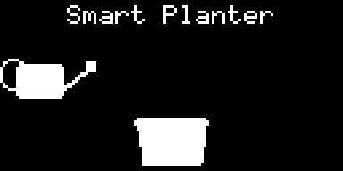
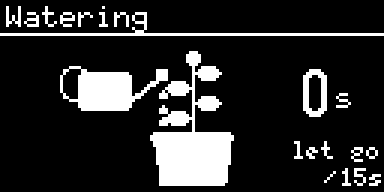
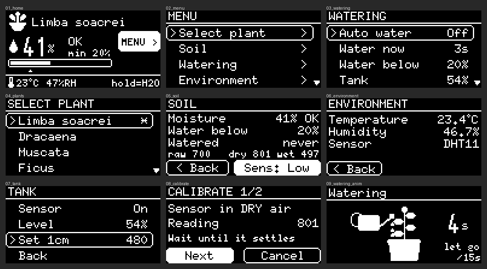

# Picurici 1.0 – Smart Planter 🌱

An open-source plant-watering robot built on an **Arduino Uno**. It measures soil moisture, air temperature and humidity and the water left in the tank, and waters the plant automatically or on demand. A small OLED screen and one rotary knob drive the whole menu.

Made for the **NEXTLAB.TECH 2026 national robotics competition – Robotică Creativă**.

 



---

## Features

- **Home screen:** plant name, soil moisture % with the plant's target, temperature, humidity and status
- **16 indoor plants** (Romanian names), each with its own watering level
- **Auto watering:** 3-second bursts when the soil is drier than the plant needs, a 60-second soak pause between bursts, and a safety stop (shows **!CHECK**) if 6 bursts in a row don't help
- **Hand watering:** hold the knob to water (stops when you let go, max 15 s), or *Watering → Water now* for a 3-second burst
- **Water tank sensor:** pauses auto watering when about 1 cm of water is left (**!REFILL** on Home). Manual watering always works as an override. The sensor can be switched off in the menu
- **Calibration on the device:** soil sensor (dry / wet), tank "1 cm left" level, and a soil sensitivity setting
- **Three languages:** English, Română, Français
- **Animations:** a startup animation and a watering animation with a seconds counter
- **Saved settings:** plant, language, calibration and auto watering are stored in EEPROM and survive power cuts
- **Safety:** every pump run has a time limit, the relay is off at boot and after any reset, and a watchdog restarts the board if the program ever freezes

---

## Parts list

| # | Part | Notes |
|---|---|---|
| 1 | **Arduino Uno R3** (or compatible) | the brain |
| 1 | **1.54" 128×64 I²C OLED**, SSD1309 controller (e.g. Heltec) | an SH1106 1.3" also works, see *Settings* |
| 1 | **KY-040 rotary encoder** with push button | the only control |
| 1 | **Soil moisture sensor** with analog output (AO) | capacitive or resistive |
| 1 | **DHT11** temperature/humidity module (3-pin) | a DHT22 also works, auto-detected |
| 1 | **HW-038 water level sensor** | goes in the water tank |
| 1 | **1-channel relay module**, 5V | active LOW (most common); active HIGH supported, see *Settings* |
| 1 | **5V submersible water pump** + silicone tube | |
| 1 | Water tank (bottle, box…) | |
| – | Breadboard, jumper wires | |
| – | Power: USB or a 7–12V supply into the Arduino's barrel jack | |

---

## Wiring

| Arduino pin | Connect to | Notes |
|---|---|---|
| **D2** | Encoder **SW** | |
| **D3** | Encoder **DT** | |
| **D4** | Encoder **CLK** | |
| **D7** | Relay **IN** | |
| **D8** | Water level sensor **+** | powered only while reading (slows corrosion) |
| **D12** | Soil sensor **+ / VCC** | powered only while reading (slows corrosion) |
| **A0** | Soil sensor **AO** | |
| **A1** | DHT11 **S / DATA** | |
| **A2** | Water level sensor **S** | |
| **A4** | OLED **SDA** | |
| **A5** | OLED **SCL** | |
| **5V** | OLED VCC, DHT11 +, encoder +, relay VCC | share with a breadboard rail |
| **GND** | every module's GND / − | all grounds must be connected together |
| D0 / D1 | **nothing** | the Uno needs these for uploading |

**Pump:** connect the pump through the relay's switch contacts (COM / NO), not straight to an Arduino pin.

**Important tips:**
- Power the **OLED from 5V**. On 3.3V it can glitch.
- Only the soil sensor's **AO** pin goes to A0. Leave its DO pin unconnected.
- Keep the **water level sensor's electronics above the water**. Only the striped part may be wet.

---

## Software setup

### Option A – Arduino IDE (easiest)

1. Install the **Arduino IDE** (2.x).
2. *Library Manager* → install **U8g2** (by oliver). `Wire` and `EEPROM` come with the IDE.
3. Open **`firmware/Picurici/Picurici.ino`**.
4. *Tools → Board → Arduino Uno*, pick the port, click **Upload**.

### Option B – PlatformIO / VS Code (plain C++)

1. Install **VS Code** and the **PlatformIO** extension.
2. Open the folder **`firmware/platformio/`**.
3. Click **Build**, then **Upload**. PlatformIO installs U8g2 automatically.

`firmware/platformio/src/main.cpp` is the same program as the `.ino`, written as standard C++ (with `#include <Arduino.h>` and the function declarations the Arduino IDE normally adds for you).

---

## First start

1. A startup animation plays, then the Home screen appears.
2. **Calibrate the soil sensor:** *Menu → Watering → Calibrate*.
   1. Hold the sensor in dry air, wait until the number settles, click **Next**.
   2. Put it in a glass of water up to its line, wait, click **Save**.
3. **Set the tank level:** *Menu → Watering → Tank*. Let the water drop to about 1 cm on the sensor, then click **Set 1cm**.
4. **Pick your plant:** *Menu → Select plant*.
5. **Turn on auto watering:** *Menu → Watering → Auto water → On*.
6. Optional: *Menu → Language* (English / Română / Français), and *Menu → Soil → Sens* to make the moisture reading more sensitive.

## Controls

| Action | What it does |
|---|---|
| **Turn** | move the highlight |
| **Click** | select |
| **Hold** (on Home or the Watering screen) | water by hand while held (max 15 s) |

---

## Settings in the code

All at the top of the program:

| Setting | Default | Meaning |
|---|---|---|
| `AUTO_PULSE_MS` | 3000 | length of one auto-watering burst (ms) |
| `AUTO_SOAK_MS` | 60000 | wait after watering before auto can water again (ms) |
| `AUTO_MAX_PULSES` | 6 | bursts in a row without reaching the target before it stops and shows !CHECK |
| `MANUAL_MAX_MS` | 15000 | longest hand-watering run (ms) |
| `MANUAL_PULSE_MS` | 3000 | *Water now* burst (ms) |
| `RELAY_ACTIVE_LOW` | true | set `false` if your relay switches on with HIGH |
| `PUMP_ENABLED` | 1 | `0` locks the pump off (useful for testing) |
| `USE_REAL_SOIL_SENSOR` | 1 | `0` uses demo values |
| `USE_DHT_SENSOR` | 1 | `0` uses demo values |
| `USE_TANK_SENSOR` | 1 | `0` removes the tank sensor completely |
| `DISPLAY_SSD1309` | 1 | `0` for SH1106 (1.3") OLED screens |
| `SERIAL_DEBUG` | 0 | `1` prints every event to the Serial Monitor (115200 baud) |
| `PIN_…` | see Wiring | change if you wire things differently |

The plant list and each plant's watering level are in the `PLANTS[]` table. All on-screen text, in all three languages, is in the `TEXT_EN` / `TEXT_RO` / `TEXT_FR` blocks.

---

## Troubleshooting

| Problem | Fix |
|---|---|
| Upload fails ("not in sync") | Something is plugged into D0/D1, or the Serial Monitor is open. Unplug it / close the monitor. |
| Screen glitches or freezes | Power the OLED from **5V**, keep SDA/SCL wires short. |
| Turning the knob goes the wrong way | Set `ENC_REVERSE = true`. |
| Need two notches per step | Set `ENC_HALF_STEP = true`. |
| Pump runs when it should be off | Set `RELAY_ACTIVE_LOW` to the other value. |
| Relay LED glows dimly / relay stays on | Power the relay from the Arduino's 5V and share GND. |
| Soil shows "Error" / !SENSOR | Check the soil sensor wires (AO → A0, + → D12). |
| Temperature shows "--" | Check the DHT11 (S → A1, + → 5V, − → GND). |
| Moisture always 0% or 100% | Run *Watering → Calibrate* again. |

---

## How it works (short)

- The knob is read with a **pin-change interrupt**, so no turn or click is missed while the screen redraws.
- Sensors that sit in water or soil (soil and tank) are **powered only for a few milliseconds per reading** to slow corrosion.
- Auto watering waters in **short bursts with soak pauses**, so the sensor sees the water arrive before the next burst, and it gives up with a warning instead of emptying the tank.
- The display driver checks every I²C transfer and **redraws if a transfer fails**, which keeps the picture clean even with long wires.
- All text lives in **flash memory**, not RAM, so three languages fit on an Uno.

## Project structure

```
Picurici/
├── README.md                    this guide
├── LICENSE                      MIT licence
├── firmware/
│   ├── Picurici/Picurici.ino    Arduino IDE sketch
│   └── platformio/              same program as plain C++ (PlatformIO)
│       ├── platformio.ini
│       └── src/main.cpp
└── docs/
    ├── intro.gif                startup animation
    ├── watering.gif             watering animation
    └── screens.png              all screens
```

## Licence

Picurici is open source under the **MIT licence** (see [LICENSE](LICENSE)). You may use, change and share it freely, including in your own projects. Just keep the copyright notice.

Uses the **[U8g2](https://github.com/olikraus/u8g2)** display library by olikraus (BSD 2-clause licence).
